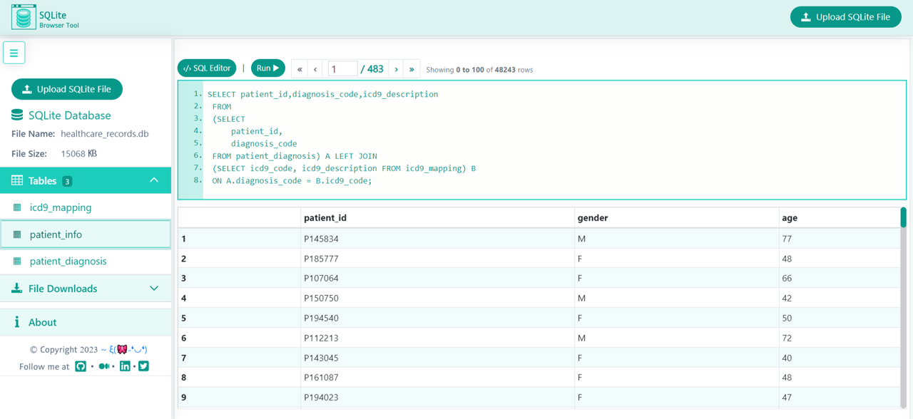
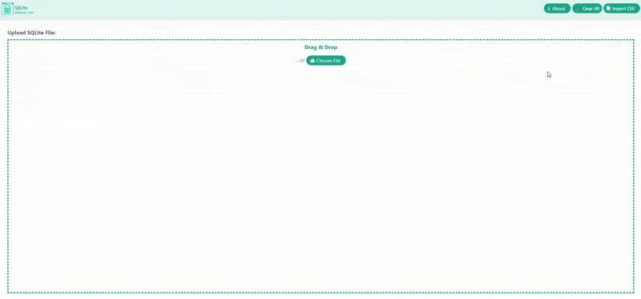
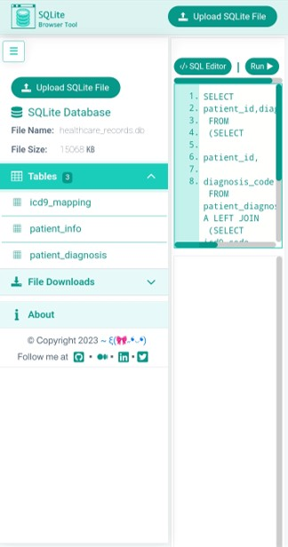
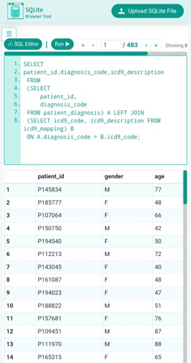

  

  # 💻 SQLite Browser Utility

  ### 🛠️ Read & Export SQLite Data in a JavaScript-enabled Browser. No server setup required. Just 🖱 double-click HTML file.

**Original work by kripken (<a href='https://github.com/sql-js/sql.js' target='_blank'>sql.js</a>). <code>C</code> to <code>JavaScript</code> compiler by kripken (<a href='https://github.com/emscripten-core/emscripten' target='_blank'>emscripten</a>).**

### 👀 Preview

#### Demo (1) File Import

#### Demo (2) Data Export

### 🌟 Try it yourself
[**Live Demo :: Link**](https://incubated-geek-cc.github.io/SQLiteBrowserUtility/)

[**Download :: Latest release**](https://github.com/incubated-geek-cc/SQLiteBrowserUtility/releases/latest) 

### ✍ Read related post here

[**Article :: Link :: 5 Key MySQL Operations which SQLite Commands can Emulate**](https://medium.com/geekculture/5-key-mysql-operations-which-sqlite-commands-can-emulate-b7a1a202856d)
 
[**Article :: Link :: Implement SQLite on web with JavaScript — both Node & Browser with sql.js plugin**](https://medium.com/weekly-webtips/implement-sqlite-on-web-with-javascript-both-node-browser-with-sql-js-14448fd7a3cb)
 
[**Article :: Link :: Read & Export SQLite Data in a JavaScript-enabled Browser Locally**](https://medium.com/weekly-webtips/read-export-sqlite-data-in-a-javascript-enabled-browser-locally-b655deda879d)
 
[**Article :: Link :: How To Load & Run Local WASM Modules Without A Server Using Client-Side JavaScript**](https://geek-cc.medium.com/how-to-load-run-local-wasm-modules-without-a-server-using-client-side-javascript-692f7b89da7d)

### ⚠ Current Status: WIP

As of October 2023, UI has been changed to:

#### Preview (1) On laptops and desktops

As of July 2025, import CSV file has been imbued into SQLite Browser Tool:

#### Preview (2) On mobile

<table>
	<thead>
		<tr>
			<th>With sidebar</th>
			<th>Without sidebar</th>
		</tr>
	</thead>
	<tbody>
		<tr>
			<td></td>
			<td></td>
		</tr>
	</tbody>
</table>

	<strong>「✓」</strong> Include code editor and browse tables into a single view 
	<strong>「✓」</strong> Code editor wrap lines toggle button 
	<strong>「✓」</strong> Mobile-responsiveness 
	<strong>「✓」</strong> Replace code editor area with latest query reflected i.e. when table is selected 
	<strong>「✓」</strong> Export sample database 
	<strong>「✓」</strong> Export updated database 
	<strong>「✓」</strong> Include 'Reset' ⟲ button (clear cache & reload page) 
	<strong>「✓」</strong> UI/UX refinement - e.g. disable/enable selections before/after uploads, drag & drop file feature added

— <b>Join me on 📝 <b>Medium</b> at <a href='https://medium.com/@geek-cc' target='_blank'>~ ξ(🎀˶❛◡❛) @geek-cc</a></b>

---

## Sample data and citations

The sample database and exports are in the repository (they are not included in the release zip):
- [`database_files/healthcare_records.db`](https://github.com/incubated-geek-cc/SQLiteBrowserUtility/blob/main/database_files/healthcare_records.db) (used by "Export sample database")
- [`exports/`](https://github.com/incubated-geek-cc/SQLiteBrowserUtility/tree/main/exports): example JSON, SQL and zip exports

**Dataset:** from the Patient-Disease-Drug (PDD) Graph project.
- Project: http://pdd.wangmengsd.com/
- Write-up: https://github.com/wangmengsd/pdd-graph
- Patient Clinical Dataset (June 2001 to October 2012): [`pdd_nt.tar.gz`](https://pdd-1254410284.cos.ap-shanghai.myqcloud.com/pdd_nt.tar.gz) (.nt format)
- License: PDD Graph is licensed under [CC BY 4.0](http://creativecommons.org/licenses/by/4.0/). Changes: a subset was extracted and converted to SQLite (`healthcare_records.db`) and JSON/SQL exports.

**Data citations:**
- Johnson AEW, Pollard TJ, Shen L, Lehman L, Feng M, Ghassemi M, Moody B, Szolovits P, Celi LA, Mark RG. MIMIC-III, a freely accessible critical care database. *Scientific Data* (2016). DOI: [10.1038/sdata.2016.35](http://www.nature.com/articles/sdata201635)
- Wang M, Zheng J, Liu J, Hu W, Wang S, Li X, Liu W. PDD Graph: Bridging Electronic Medical Records and Biomedical Knowledge Graphs via Entity Linking. In *International Semantic Web Conference (ISWC)*. Springer, Cham, 2017: 219–227.

**Other external data references:**
- Drug names and drug interactions from DrugBank. Wishart DS, Knox C, Guo AC, Shrivastava S, Hassanali M, Stothard P, Chang Z, Woolsey J. DrugBank: a comprehensive resource for in silico drug discovery and exploration. *Nucleic Acids Res.* 2006 Jan 1;34(Database issue):D668-72. PMID: 16381955.
- ICD-9 codes and descriptions from [Dexur](https://dexur.com/icd/search/?q=) and [BioPortal (ICD9CM)](http://purl.bioontology.org/ontology/ICD9CM/).

## License

[MIT](LICENSE) © 2022 CharmaineC. Built on [sql.js](https://github.com/sql-js/sql.js), MIT, see [`LICENSE-sql.js.txt`](LICENSE-sql.js.txt).

#### 🌮 Please buy me a <a href='https://www.buymeacoffee.com/geekcc' target='_blank'>Taco</a>! 😋